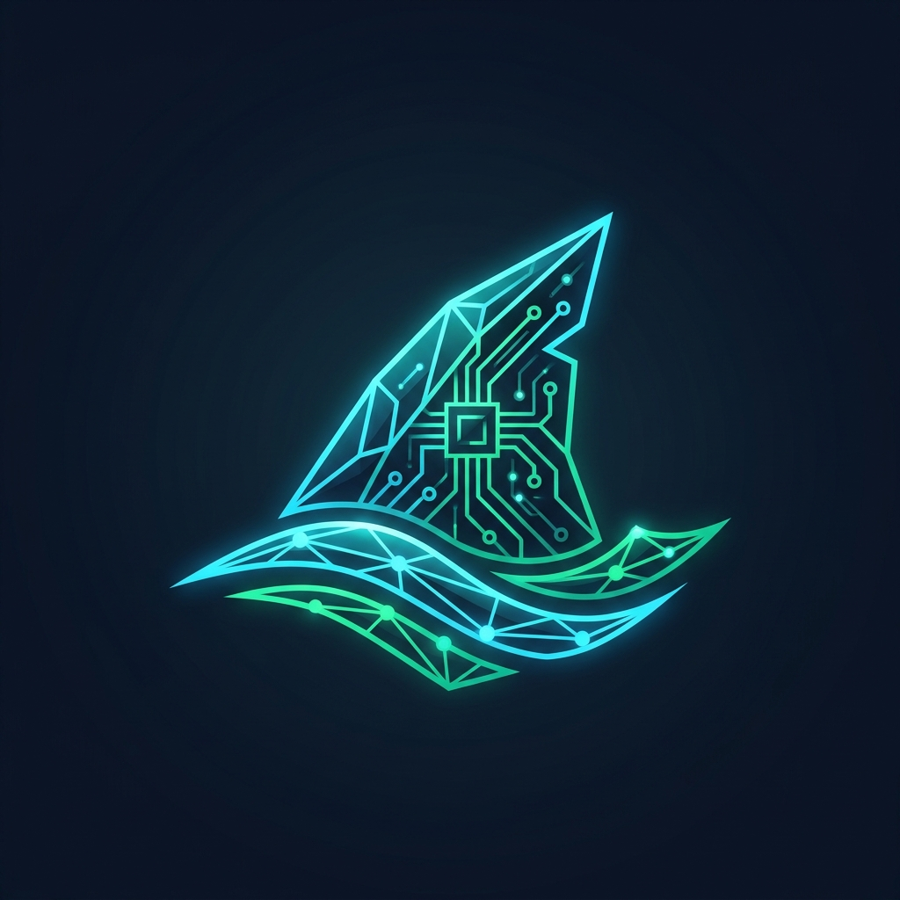

<div align="center">



# 🦈 VirtualShark Pro
### Suite de Topología Visual Cisco & Análisis Wireshark para VirtualBox

[](LICENSE)
[](https://python.org)
[](https://www.virtualbox.org/)
[](https://www.wireshark.org/)
[]()

*Automatización completa de capturas `.pcap`, mapeo gráfico de switches virtuales y simulación interactiva de paquetes ICMP.*

</div>

---

## 💡 ¿Qué es VirtualShark Pro?

**VirtualShark Pro** es una herramienta de escritorio open-source diseñada para estudiantes, profesores y profesionales de redes. Llena el vacío entre la planificación visual lógica (estilo **Cisco Packet Tracer**) y la inspección real de paquetes (con **Wireshark**) trabajando directamente sobre tus máquinas virtuales de **Oracle VM VirtualBox**.

---

## 🌟 Características Destacadas

### 1. 🌐 Topología Dinámica y Detección Multirred
* **Detección Automática de Capa 2 y Capa 3**: Escanea en tiempo real todas las VMs y detecta qué adaptadores están conectados a qué switches internos (`intnet`) o redes `hostonly`.
* **Separación de Prácticas / Redes Independientes**: Con el nuevo **Selector de Topología**, puedes alternar entre tus laboratorios (ej. `Red_LAN_A / B`, `Host-Only #3`, `LaboratorioAD`, etc.) o ver todo el mapa global.
* **Lienzo Interactivo (Drag & Drop)**: Arrastra y acomoda equipos y switches con el mouse. Botón **`Auto-Acomodar`** para centrar la vista.
* **Cables y LEDs en Tiempo Real**: Visualiza interfaces (`nic1`, `nic2`) y luces LED de conexión (verde encendido / rojo apagado).

### 2. ✉️ Simulador y Animación de Paquetes ICMP (Ping)
* Elige cualquier equipo de origen y destino en el mapa y envía un ping simulado:
  * **Animación en Vivo**: Un paquete luminoso recorre los cables y switches hacia el destino.
  * 🟢 **Capa 2 Directa**: Si comparten switch virtual (sin pasar por router).
  * 🟡 **Capa 3 Enrutada**: Si viaja a través de un router intermedio entre dos redes.
  * 🔴 **Destino Inalcanzable**: Notificación en rojo si las redes están aisladas.
* **Matriz Completa de Red (NxN)**: Tabla de conectividad instantánea de todos los pares de máquinas.

### 3. 🦈 Captura Automatizada & Wireshark
* Inicia capturas `.pcap` en cualquier VM/adaptador con un clic vía `VBoxManage controlvm / modifyvm`.
* Nombra los archivos automáticamente con fecha y hora exactas en tu carpeta de Documentos.
* Lista visual (`Treeview`) con fecha, tamaño y estado.
* Botón directo **"Abrir con Wireshark"** para inspeccionar tramas y paquetes reales al instante.

---

## 🚀 Instalación y Uso

### Prerrequisitos
1. [Python 3.10+](https://www.python.org/)
2. [Oracle VM VirtualBox](https://www.virtualbox.org/)
3. [Wireshark](https://www.wireshark.org/)

### Clonar y Ejecutar
```bash
# 1. Clonar el repositorio
git clone https://github.com/tu-usuario/virtual_shark.git
cd virtual_shark

# 2. Instalar dependencias
pip install -r requirements.txt

# 3. Iniciar la aplicación
python virtual_shark.py
```

*En Windows también puedes hacer doble clic en `iniciar_virtualshark.bat`.*

---

## ⚖️ Aviso Legal y Marcas Comerciales (Trademark Disclaimer)

Este proyecto es una herramienta independiente desarrollada con fines educativos y de investigación:

* **Wireshark** y el logotipo de la aleta de tiburón son marcas comerciales registradas de Gerald Combs / Wireshark Foundation.
* **VirtualBox** es una marca comercial registrada de Oracle Corporation y/o sus filiales.
* **Cisco** y **Packet Tracer** son marcas comerciales registradas de Cisco Systems, Inc.

*VirtualShark Pro cuenta con un logotipo e identidad visual propia ("Cyber Shark"), es un software de código abierto bajo la Licencia MIT y no está afiliado, patrocinado, respaldado ni asociado oficialmente con Oracle Corporation, Wireshark Foundation ni Cisco Systems, Inc.*
